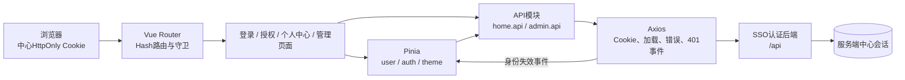
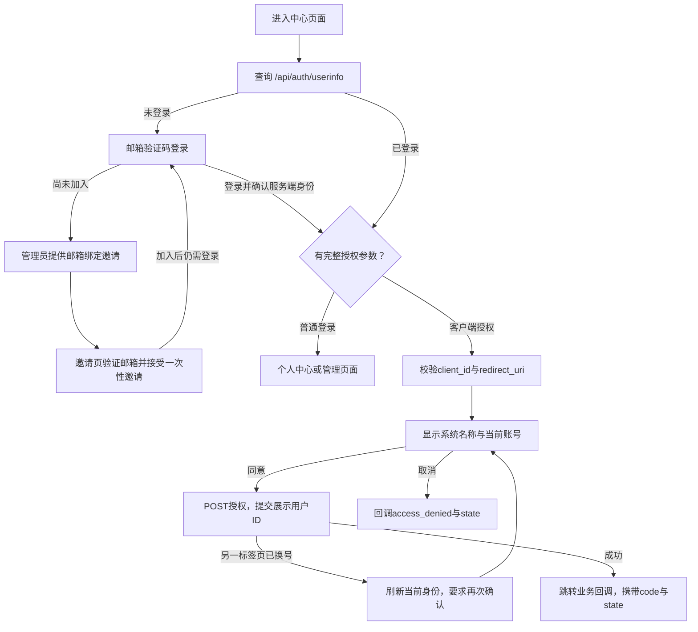
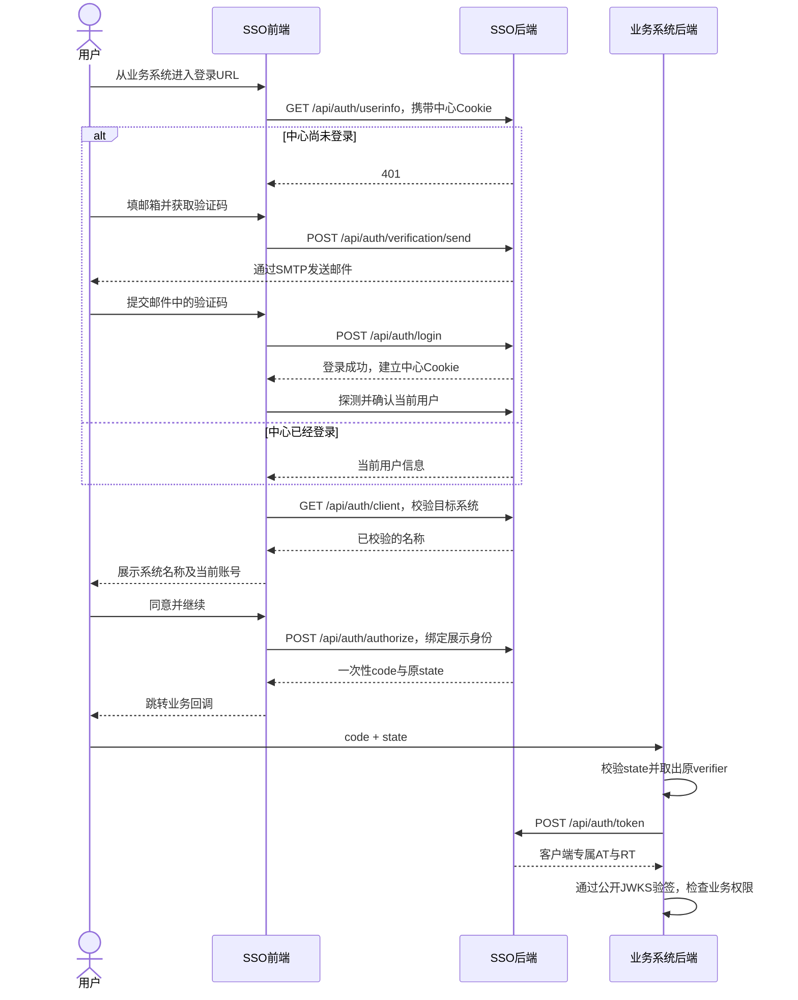

# SSO 登录与管理前端

[](https://vuejs.org/)
[](https://vite.dev/)
[](https://www.typescriptlang.org/)
[](https://element-plus.org/)

统一登录中心的Vue前端，与相邻的 [sso-auth认证后端](../sso-auth/README.MD) 配套使用，提供组织邀请、成员邮箱登录、中心会话探测、授权确认、个人信息和管理后台。

**前端负责“用户看到和确认什么”，后端负责“身份及权限是否有效”。** 本中心前端不保存业务Access/Refresh Token，不需要私钥，也不是业务系统的资源API。

## 目录

- [核心功能与技术栈](#核心功能与技术栈)
- [前端架构与职责](#前端架构与职责)
- [注册、登录和授权的页面流程](#注册登录和授权的页面流程)
- [快速开始](#快速开始)
- [使用教程](#使用教程)
- [请求、状态和主题管理](#请求状态和主题管理)
- [开发指南](#开发指南)
- [构建、预览与部署](#构建预览与部署)
- [测试与常见问题](#测试与常见问题)

## 核心功能与技术栈

### ✨ 核心功能

- **邀请制组织成员**：管理员创建邮箱绑定邀请，受邀人验证邮箱加入；公开页面只提供成员登录与名单管理员初始化，普通用户不能自由注册。
- **默认拒绝平台**：受邀加入不会自动开通任何平台。管理员按用户逐项允许或强退封禁，业务权限仍由业务端管理。
- **中心会话复用**：页面导航时向后端探测会话，已有中心Cookie可跳过验证码登录。
- **按系统确认授权**：显示经过后端校验的系统名称和当前账号，用户同意或取消后回到业务方。
- **个人中心**：展示当前中心用户的姓名和邮箱。
- **管理后台**：接入系统配置、启停/删除、用户会话查询、强退、统计及最近审计。
- **会话异常恢复**：401清理本地身份，保留待完成授权参数；网络故障不永久缓存为退出。
- **亮暗主题**：手动偏好可持久化，未手动设置时跟随系统，重载后各DOM主题标志一致。

### 技术栈

| 分类 | 技术 | 用途 |
| --- | --- | --- |
| 框架 | Vue3、Composition API、SFC | 页面与响应式组件 |
| 构建 | Vite7 | 开发代理、类型检查配套构建、生产预览 |
| 语言 | TypeScript5.x、vue-tsc | 应用/API/组件类型 |
| UI与样式 | Element Plus、Tailwind CSS4 | 表单、管理表格、对话框及主题样式 |
| 路由 | Vue Router4，Hash模式 | 登录、授权、个人中心、管理和错误页面 |
| 状态 | Pinia、持久化插件 | 展示身份与动作状态；不替代服务器会话 |
| HTTP | Axios | Cookie请求、加载提示、错误与会话事件 |
| 图标 | Iconify、按需导入的Element Plus图标 | 页面图标，不全量注册 |
| 时间显示 | dayjs | 管理记录时间格式化 |
| 质量检查 | ESLint、Prettier、Vitest、Vue Test Utils | 代码检查、状态/路由/组件回归 |
| 提交工具 | Commitlint、Commitizen、Git hooks | 提交格式约束 |

运行基线推荐 **Node.js 24.15+（24.x LTS）、pnpm10**，覆盖当前锁定的Vite/jsdom依赖。

## 前端架构与职责

### 架构图



### 各层负责什么？

| 层 | 作用 |
| --- | --- |
| 页面 | 表单与授权展示、用户交互、管理对话框 |
| 路由守卫 | 探测服务端身份、保留授权上下文、控制页面访问体验 |
| user store | 当前展示身份、合并在途探测、拒绝迟到的旧身份响应 |
| auth store | 发验证码、注册、登录、明确授权、退出及错误提示 |
| theme store | 单一主题偏好与DOM同步，不和Pinia JSON重复保存同一个键 |
| HTTP/API层 | 发送Cookie请求，处理加载提示、业务错误和身份失效事件 |
| 后端 | 验证邮箱/会话/管理员，精确检查客户端与回调，签发及撤销凭据 |

中心会话保存在**后端Redis**，浏览器持有HttpOnly Cookie。Pinia/localStorage只是展示缓存，不能靠修改 `isLoggedIn` 或 `isAdmin` 获得真实权限。

业务系统另外通过code + PKCE换取Token，并由自己的后端验签。**这不是中心前端保存Token或共享各业务Session的架构。**

## 注册、登录和授权的页面流程



### 页面与请求时序



SSO前端的 `/#/callback` 实际是**授权确认页**，不是业务系统接收code的回调地址。业务回调由注册的 `redirect_uri` 决定。

## 快速开始

### 1. 确认后端已准备好

两个项目作为相邻目录使用。先按 [后端README](../sso-auth/README.MD#快速开始) 配好MySQL、Redis、SMTP及开发RSA密钥，执行迁移，并在后端目录运行：

```bash
pnpm dev
```

后端默认 `http://127.0.0.1:3000`，前端开发地址使用 `http://localhost:5173`。真实邮件登录不能使用固定开发验证码。

### 2. 安装并启动前端

在 `sso-auth-front` 目录执行：

```bash
pnpm install --frozen-lockfile
pnpm dev
```

打开 **`http://localhost:5173/#/login`**。

开发请求使用 `/proxy/api/...`，Vite去掉 `/proxy` 后转发到后端 `/api/...`。这不是把Cookie或数据库暴露给业务系统。

### 3. 初次登录

1. 第一位管理员在后端 `ADMIN_EMAILS` 配置自己的邮箱，在“管理员初始化”验证邮箱并登录；已有名单账号可正常登录完成成员初始化。
2. 管理员在 `/#/admin` 创建邀请并复制链接发送给目标邮箱所有者。
3. 受邀人打开 `/#/invite?token=...`，邮箱不可改，验证后加入并回登录页；已有待加入账号保留ID与姓名。
4. **所有业务平台默认未开通**，管理员通过用户的“平台准入”逐项开通。名单管理员也没有自动平台特权。
5. 普通访客不能用无邀请注册或验证码旁路加入组织。

若5173被占用，要核对Vite实际使用的端口：解决冲突，或同步修改后端可信Origin。不要关闭来源校验来掩盖配置错误。

## 使用教程

### 路由入口

| 地址 | 用途 | 要求 |
| --- | --- | --- |
| `/#/login` | 组织成员登录 / 名单管理员初始化，可携带业务授权参数 | 无需先登录 |
| `/#/invite?token=...` | 检查邮箱绑定邀请并验证加入，不自动授权平台 | 有效邀请 |
| `/#/callback` | 校验客户端、确认或取消授权 | 当前中心身份 |
| `/#/profile` | 展示当前姓名和邮箱 | 当前中心身份 |
| `/#/admin` | 系统、会话与审计管理 | 后端管理员身份 |
| `/#/401` | 无访问权限提示 | 不作为管理鉴权替代 |
| `/#/404` | 未知页面提示 | 路由兜底 |

项目使用Hash路由，URL中的 `/#/` 要保留；普通进入登录页不需要OAuth参数。

### 从业务系统进入授权确认

业务系统生成本次state和PKCE参数，跳转形如：

```text
https://sso.example.com/#/login?client_id=system-1&redirect_uri=https%3A%2F%2Fapp.example.com%2Fsso%2Fcallback&state=随机state&code_challenge=S256挑战值&code_challenge_method=S256
```

- `client_id` 与注册值精确、大小写匹配。
- `redirect_uri` 与该系统配置完全一致。
- `state` 由业务侧生成、关联并在业务回调校验。
- `code_challenge` 是安全随机verifier的SHA-256/Base64url结果，不是verifier本身。
- 方法只支持S256，缺省按S256处理；业务侧建议显式提交。

这些参数全部保留到授权完成。用户看到的是后端校验过的系统名称与当前账号，不是任意URL中的显示文字。

### 同意、取消与跨标签页换号

- 同意后，前端向后端请求一次性code，再将code和state带到已注册回调。
- 取消后，将 `error=access_denied` 和state带回业务方，不创建业务登录态。
- 确认请求还带有中心前端保存的展示用户ID `expected_user_id`，它不需要业务方放进跳转URL。
- 如果另一标签页退出A并登录B，旧页面不能静默授权B；后端409，前端重新展示B，并要求用户再次同意。

### 管理后台

管理员可查看概览、邀请、接入系统、成员和最近审计；创建/编辑系统配置，邀请成员，全局强退封禁或恢复账号，并在用户的“平台准入”中逐项允许或强退封禁。没有“默认全体成员准入”模式，也不在中心管理业务角色/菜单。

名称限制1—100字符，回调至少一个有效地址；并发编辑冲突需要刷新后重新确认。系统停用撤销长期凭据，不承诺短AT即时失效。

中心会话数为0，不代表业务RT已经失效，所以封禁仍可使用；不能封禁当前操作管理员。全局封禁、平台封禁与整个客户端停用是不同范围，解除状态不恢复旧凭据。普通用户不能绕过后端鉴权自行邀请、开通平台或解除封禁。

## 请求、状态和主题管理

### Cookie与接口响应

所有中心请求使用Axios的 `withCredentials`。开发走代理，推荐生产前后端同源。Cookie为HttpOnly，前端不能把它当普通JS字符串读取或复制到业务系统。

生产中心Cookie是 `__Host-sso_sess` 和签名Cookie；开发HTTP使用 `sso_sess`。中心后端保持精确来源白名单，不能仅凭 `withCredentials` 支持任意跨站Cookie。

业务响应通常为 `{ code, msg, data }`。验证码/参数错误展示后端原因；401表示身份失效；5xx/网络错误提示临时故障，不永久假定用户已退出。

### 身份缓存与迟到响应

user store向服务端重新探测身份，并合并同时进行的探测；本地存储不能决定真实身份。登录/退出/换号推进请求身份代次，旧请求不能清掉后来成功登录的身份。

受保护请求401后，前端清理身份并按需回登录，保留授权query。错误验证码不触发全局退出；退出请求失败会提示重试，只有成功或确认中心会话已经失效时才完成本地退出。

### Token与中心会话的区别

| 凭据 | 本前端的职责 |
| --- | --- |
| 中心Cookie会话，24小时 | 用它访问中心接口并探测身份，不自动续期 |
| 业务AT，15分钟 | 不保存在本中心前端；业务API验证它 |
| 业务RT，滚动7天 | 不保存在本中心前端；业务方负责刷新/保存新Token对 |

中心会话过期不阻止有效业务RT刷新。业务系统可以直接用Token，不要求额外建立Session。公钥验签见 [三步接入](../sso-auth/KEYS.md)。

### 主题

主题只有一个持久化来源：localStorage中的 `dark` / `light` 字符串。没有手动偏好时跟随系统，手动选择后保持用户偏好；所有变化共同更新根节点class、data-theme和colorScheme。

## 开发指南

### 项目结构

```text
src/
├── main.ts / App.vue          # 应用入口、布局与会话事件
├── api/
│   ├── create-axios.ts        # 请求门面与常用选项
│   ├── index.ts               # Cookie、加载提示、错误拦截
│   ├── session-events.ts      # 请求身份代次与401通知
│   └── modules/               # home.api.ts / admin.api.ts
├── router/
│   ├── index.ts               # Hash路由和身份守卫
│   └── constant-routes/       # 页面、错误路由
├── stores/modules/            # user / auth / theme
├── components/common/         # 导航栏等公共组件
├── views/                     # 登录、授权、个人中心、管理、错误页
├── styles/                    # Tailwind、基础和Element Plus样式
├── types/                     # API/自动导入声明
└── **/__tests__/              # 状态、路由、组件回归
vite.config.ts                # 构建、开发代理、生产预览
vitest.config.ts              # 测试环境与别名
```

### 请求模块示例

现有请求模块集中在 [home.api.ts](src/api/modules/home.api.ts) 和 [admin.api.ts](src/api/modules/admin.api.ts)。添加接口时复用当前门面，例如：

```ts
import { defHttp } from '@/api';

// 获取当前中心用户信息，具体身份由后端Cookie会话决定。
export function getCurrentUser() {
  return defHttp.request<Api.Response.Base<Api.Response.UserInfo>>(
    { url: '/api/auth/userinfo', method: 'GET' },
    { returnResponseData: true, isAlertErrorMsg: false },
  );
}
```

页面自行提示错误时关闭通用重复提示，不手动拼占位Authorization头，也不把业务Token验证逻辑塞进中心前端。类型声明、路由权限和组件回归随实现一起更新。

### 常用脚本

| 命令 | 用途 |
| --- | --- |
| `pnpm dev` | 开发服务与 `/proxy` 代理 |
| `pnpm typecheck` / `pnpm type-check` | Vue/TypeScript类型检查 |
| `pnpm lint:check` | 只检查 |
| `pnpm lint` | 自动修复，会修改文件 |
| `pnpm format` | 格式化源码，会修改文件 |
| `pnpm test` | Vitest回归 |
| `pnpm build` | 类型检查并输出生产dist |
| `pnpm build-only` | 仅Vite打包 |
| `pnpm preview` | 本地预览生产包，不是生产服务器 |
| `pnpm commit` | Commitizen规范提交辅助，只有需要提交时使用 |

## 构建、预览与部署

### 本地预览生产包

后端保持开发模式 `pnpm dev` 运行，再在前端执行：

```bash
pnpm build
pnpm preview
```

访问 **`http://localhost:4173`**。端口固定，占用时明确报错，不自动换端口。

| 模式 | 浏览器请求 | 转发规则 |
| --- | --- | --- |
| dev | `/proxy/api/...` | 去掉 `/proxy`，到127.0.0.1:3000 |
| 默认生产包＋preview | `/api/...` | 保留 `/api`，到127.0.0.1:3000 |
| 正式Nginx | `/api/...` | 按同源部署配置转发 |

后端仅在development模式允许本地4173 Origin。不要用HTTP预览连接Secure Cookie生产模式，也不要将 `vite preview` 用作生产服务。

### API地址配置

默认生产 `VITE_SERVICE_BASE_URL=/`，API模块已经包含 `/api`。如果设置绝对后端地址，通常只填Origin，不重复添加 `/api`；修改需要重建。

`VITE_*` 是会编进浏览器包的公开配置，不能放密码、RSA私钥或中心秘密。绝对地址请求不经过本地代理，要自己确保可信Origin、HTTPS及Cookie同站条件。

### 正式部署概要

1. 在构建环境安装锁定依赖并执行 `pnpm build`。
2. 只将 **dist内容** 发布到Nginx静态根目录，不公开源码、`.env`、后端目录或密钥。
3. HTTPS站点同源代理 `/api` 到中心，保留此前缀。
4. 打开登录页，检查网络请求、实际邮件登录、授权确认及管理权限。

后端源码运行、证书、代理头、数据库和密钥配置的完整顺序见 [统一部署说明](../sso-auth/docs/DEPLOYMENT.md) 和 [Nginx示例](../sso-auth/deploy/nginx.conf.example)。

## 测试与常见问题

### 检查命令

```bash
pnpm typecheck
pnpm lint:check
pnpm test
pnpm build
```

前端自动测试主要使用jsdom和受控API响应，覆盖身份恢复、迟到请求、退出失败、授权快照、主题、路由权限及预览配置。它们不能替代真实邮箱、Cookie和部署环境验收。

真实浏览器联动可复用后端的隔离夹具，运行实际前后端及测试MySQL/Redis，不发送真实邮件，见 [测试说明](../sso-auth/test/README.md)。

### 常见问题

| 现象 | 优先检查 |
| --- | --- |
| 页面开了，但接口连接失败 | 后端是否启动、实际端口与代理目标是否一致 |
| userinfo首次返回401 | 未登录时的正常会话探测，不等于页面故障 |
| 请求返回403 | 根据响应原因检查组织成员资格、全局/平台封禁及是否已开通，再核对Origin与可信代理；不要关闭校验绕过 |
| 点击登录仍未登录 | 验证码用途/有效期、Cookie是否被浏览器接收、userinfo是否成功 |
| 预览读到HTML而非JSON | 使用当前 `/api` 代理配置，确认后端3000；不要只启动静态包 |
| 授权显示409 | 账号已变化或请求存在冲突，重新读取并明确确认，不自动重试 |
| 业务系统不知道怎么验签 | 看 [KEYS.md](../sso-auth/KEYS.md)，不是给本前端加私钥 |
| 修改API环境变量没有生效 | 生产变量是构建时配置，需要重新build |
| 退出失败仍显示当前账号 | 服务端身份尚未确认撤销时保留状态并提示重试，不能只清缓存冒充成功 |

项目当前是 **本地联调和回归完成、首次隔离部署测试候选**。可以开始实际HTTPS/SMTP/业务接入验收，不需要为不存在的旧生产增加兼容代码。

## 相关文档

- [独立业务演示站：系统1/系统2登录测试](../sso-business-demo/README.md)

- [后端原理、架构与接口教程](../sso-auth/README.MD)
- [完整业务接入契约](../sso-auth/INTEGRATION.md)
- [公钥验签三步上手](../sso-auth/KEYS.md)
- [前后端统一部署](../sso-auth/docs/DEPLOYMENT.md)
- [隔离测试与浏览器夹具](../sso-auth/test/README.md)

## 开发规范

遵循项目TypeScript、ESLint和Prettier约定；新增页面/接口同步类型、路由和测试。按需导入组件/图标，不恢复无人使用的全量注册；修改登录流程时保持state/PKCE上下文及后端身份边界。
